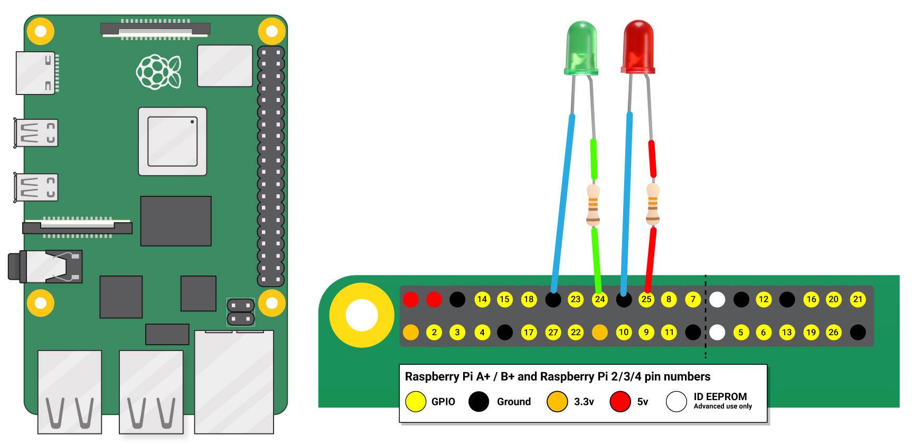

# Raspberry Pi Gemini Voice Assistant

A hands-free AI voice assistant built on a **Raspberry Pi 4 Model B** using **Python**, **Google Gemini**, speech recognition, text-to-speech, and GPIO status LEDs.

**Project adaptation and implementation: Pradip Sapkota**

This repository documents the version I built and tested as a computer engineering project. The assistant listens for a wake word, converts speech to text, sends the request to Gemini, speaks the AI response through a connected speaker, and uses LEDs to indicate listening/speaking states.

> This project is adapted from the open-source TechMakerAI Google Gemini Raspberry Pi voice chatbot. The original MIT license and attribution are preserved in `LICENSE` and `NOTICE`.

## Demo

I recorded a full hardware demonstration of the project. The demo video is intentionally not included in this ZIP because of its file size.

After uploading the video to the GitHub repository, add it here, for example:

```md
[Watch the project demo](./demo-video.mp4)
```

## Features

- Wake-word activation using **"Jack"**
- Voice input through a USB microphone
- Speech-to-text using Google Speech Recognition
- Conversational responses generated with Google Gemini
- Text-to-speech using gTTS
- Audio playback through `pygame`
- Green LED for listening/status indication
- Red LED while the assistant is speaking
- Date-stamped local conversation logs
- Separate no-LED version for testing without Raspberry Pi GPIO hardware
- Gemini API key loaded from an environment variable instead of being stored in source code

## System Overview

```text
User Speech
    |
    v
USB Microphone
    |
    v
SpeechRecognition
    |
    v
Wake Word Detection ("Jack")
    |
    v
Google Gemini API
    |
    v
gTTS Text-to-Speech
    |
    v
Speaker / Audio Output

GPIO 24 -> Green LED (listening/status)
GPIO 25 -> Red LED   (assistant speaking)
```

## Hardware

- Raspberry Pi 4 Model B
- microSD card with Raspberry Pi OS
- USB microphone
- Speaker / audio output
- 1x green LED
- 1x red LED
- Current-limiting resistors for the LEDs
- Jumper wires / breadboard as needed

## GPIO Wiring

The project uses **BCM GPIO numbering** through `gpiozero`:

| Function | BCM GPIO | LED |
|---|---:|---|
| Listening / status | GPIO 24 | Green |
| Assistant speaking | GPIO 25 | Red |



Always use an appropriate resistor in series with each LED.

## Repository Structure

```text
.
├── GVA4Pi1.py                  # Raspberry Pi version with GPIO LEDs
├── GVA4Pi1_NoLED.py            # Version without GPIO LED control
├── requirements.txt            # Python dependencies
├── .env.example                # Environment-variable template
├── .gitignore                  # Files that should not be committed
├── LICENSE                     # Original MIT license
├── NOTICE                      # Attribution and adaptation notice
├── assets/
│   └── raspberry_pi_led_wiring.jpg
└── README.md
```

## Setup

### 1. Clone the repository

```bash
git clone <your-repository-url>
cd <your-repository-folder>
```

### 2. Create a virtual environment

```bash
python3 -m venv .venv
source .venv/bin/activate
```

On Windows:

```powershell
.venv\Scripts\activate
```

### 3. Install dependencies

```bash
pip install -r requirements.txt
```

Depending on the Raspberry Pi OS image and microphone configuration, PyAudio may also require system audio development packages before `pip` can install it successfully.

### 4. Set your Gemini API key

Do **not** place the API key directly in the Python files.

Linux / Raspberry Pi OS:

```bash
export GOOGLE_API_KEY="your_api_key_here"
```

Windows PowerShell:

```powershell
$env:GOOGLE_API_KEY="your_api_key_here"
```

You can copy `.env.example` as a reference, but this program reads the key from the process environment.

## Run the Project

### Raspberry Pi version with LEDs

```bash
python3 GVA4Pi1.py
```

### No-LED version

```bash
python3 GVA4Pi1_NoLED.py
```

Say **"Jack"** followed by a question to wake the assistant. Once awake, it continues the conversation without requiring the wake word for every request.

Say **"that's all"** to end the active conversation and return the assistant to sleep mode.

## How It Works

1. The microphone continuously waits for speech.
2. While sleeping, the assistant ignores speech unless the wake word **"Jack"** is detected.
3. Speech is converted into text with the `SpeechRecognition` library.
4. The text is sent to a Gemini chat session.
5. The response is streamed back in chunks.
6. Each response chunk is converted to audio using gTTS and played with `pygame`.
7. On the Raspberry Pi version, GPIO LEDs provide simple visual status feedback.
8. User and AI messages are written to a local date-stamped log file.

## Configuration

The following constants can be edited near the top of the Python files:

```python
WAKE_WORD = "jack"
EXIT_PHRASE = "that's all"
LANGUAGE = "en-US"
MAX_OUTPUT_TOKENS = 168
```

The Gemini model can also be changed without editing source code:

```bash
export GEMINI_MODEL="gemini-pro"
```

## Security Notes

- Never commit your Gemini API key.
- `.env`, local chat logs, Python cache files, and virtual environments are ignored by Git.
- If a key is ever accidentally committed, revoke it and create a new one.

## Skills Demonstrated

This project demonstrates practical experience with:

- Raspberry Pi and GPIO interfacing
- Python application development
- API integration
- Speech recognition and text-to-speech
- Basic hardware/software integration
- Event-driven conversational interaction
- Linux/Raspberry Pi development and testing

## Attribution

This project is an adaptation of the TechMakerAI **Google Gemini Voice Chatbot on Raspberry Pi** project and remains subject to the included MIT license. Changes and project implementation in this repository are documented by **Pradip Sapkota**.

See `NOTICE` for additional details.
